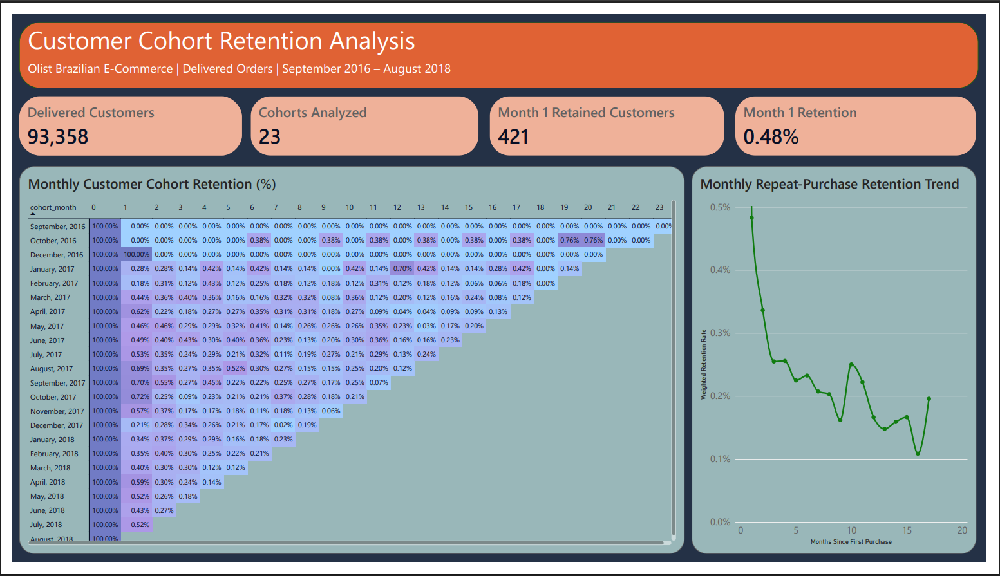

# E-commerce Customer Intelligence & Retention Analytics

An end-to-end e-commerce analytics project combining Python, MySQL, SQL, Power BI and Streamlit to understand customer purchasing behavior, spending patterns, customer segmentation and retention.

The project includes a multi-page interactive web application, executive reporting, customer intelligence and cohort retention analysis.

**Repository:** [E-commerce Customer Intelligence](https://github.com/rahul-patel74/ecommerce-customer-intelligence)

---

## 1. Project Overview

Customer acquisition, purchasing behavior and retention are important factors in understanding e-commerce business performance.

This project analyzes the Brazilian E-Commerce Public Dataset by Olist to investigate how customers purchase, how frequently they return, how much they spend and how different customer groups behave over time.

The project combines data exploration, data cleaning, relational database management, SQL-based business analysis, customer segmentation and interactive visualization.

It also includes a Streamlit web application called **E-commerce IQ | Intelligence Studio**, which brings the analytical findings together in an interactive business intelligence experience.

### Project Components

- Python-based data understanding, cleaning and validation.
- MySQL database design and data ingestion.
- SQL-based customer and business analysis.
- RFM customer segmentation.
- Monthly cohort retention analysis.
- Power BI cohort retention dashboard.
- Interactive multi-page Streamlit analytics application.
- Filter-aware PDF, HTML and CSV reporting.

## 2. Business Objectives

- Understand customer purchasing behavior and purchase frequency.
- Identify one-time and repeat customers.
- Analyze customer spending patterns.
- Examine geographic distribution of customers.
- Analyze product category and order performance.
- Segment customers using Recency, Frequency and Monetary (RFM) analysis.
- Evaluate repeat-purchase behavior through monthly cohort analysis.
- Identify potential opportunities for customer engagement and retention improvement.
- Present business findings through interactive dashboards and downloadable reports.

## 3. Dataset

**Dataset:** Brazilian E-Commerce Public Dataset by Olist

**Source:** [Kaggle Dataset](https://www.kaggle.com/datasets/olistbr/brazilian-ecommerce)

The dataset contains historical Brazilian e-commerce transactions and related information covering 2016–2018.

It consists of nine CSV files:

| Dataset | Records |
|---|---:|
| Customers | 99,441 |
| Orders | 99,441 |
| Order Items | 112,650 |
| Order Payments | 103,886 |
| Order Reviews | 99,224 |
| Products | 32,951 |
| Sellers | 3,095 |
| Geolocation | 1,000,163 |
| Category Translation | 71 |

The nine datasets were imported into a relational MySQL database containing nine corresponding tables.

Relationships were established using primary and foreign keys where appropriate.

**Dataset availability:** The original raw CSV files are not included in this repository. Download the dataset from Kaggle and place the files inside the local `data/raw/` directory.

The raw and processed data directories are excluded from Git. The repository includes a separate set of curated aggregate CSV snapshots in `app_data/` for the deployed Streamlit application.

## 4. Technology Stack

| Technology | Purpose |
|---|---|
| Python | Data exploration, cleaning, validation and application logic |
| Pandas | Data inspection, cleaning and manipulation |
| NumPy | Numerical operations |
| Jupyter Notebook | Interactive Python analysis |
| MySQL | Relational database management |
| SQL | Joins, aggregations, CTEs and window functions |
| Streamlit | Multi-page interactive web application |
| Plotly | Interactive charts and visualizations |
| DAX | Power BI KPI calculations and analytical measures |
| Power BI | Cohort retention dashboard |
| ReportLab | PDF report generation |
| Git & GitHub | Version control and project management |

## 5. Project Workflow

### 5.1 Data Understanding and Quality Assessment

Used Python and Pandas to inspect the nine source datasets and understand their structure.

Activities included:

- Dataset dimensions and column inspection.
- Data type examination.
- Missing-value analysis.
- Exact duplicate investigation.
- Primary and composite key validation.
- Duplicate review ID investigation.
- Geolocation duplicate analysis.
- ZIP-code and product-category lookup validation.
- Identification of unmatched records and unusual data patterns.

The findings and data-quality issues were documented before proceeding with the cleaning and SQL analysis.

### 5.2 Python Data Cleaning and Validation

Implemented a Python-based data cleaning and validation pipeline using Pandas and NumPy.

The pipeline covered all nine datasets.

**Text normalization**

- Removed leading and trailing whitespace from text columns.
- Converted whitespace-only review titles into missing values: 2.
- Converted whitespace-only review messages into missing values: 27.

**Datetime conversion**

- Converted eight date columns across orders, order items and reviews into datetime format.
- Successfully parsed all non-missing date values.
- Found zero invalid date values.

**Data type standardization**

- Converted customer, seller and geolocation ZIP prefixes into string data types to preserve leading zeros.
- Converted seven product attributes into Pandas nullable integer (`Int64`) types after verifying that all non-missing values were whole numbers.

**Duplicate investigation**

- Identified 261,831 exact duplicate rows in the geolocation dataset.
- Found no exact duplicate rows in the other eight datasets.
- Retained geolocation duplicates rather than removing records without sufficient evidence that they were invalid.

**Key and relationship validation**

- Validated eight primary and composite key definitions.
- Validated six core foreign-key relationships.
- All tested keys and core relationships passed validation.

**Supplementary lookup validation**

| Lookup Relationship | Unmatched Rows | Unique Values |
|---|---:|---:|
| Customer ZIP to geolocation | 278 | 157 |
| Seller ZIP to geolocation | 7 | 7 |
| Product categories to translations | 13 | 2 |

Additionally, 610 products had missing category values.

The two unmatched product categories were:

- `portateis_cozinha_e_preparadores_de_alimentos`
- `pc_gamer`

These records were retained rather than assigning invented postal-code mappings or category translations.

**Numeric validation and anomaly investigation**

- Two credit-card payment records contained zero installments. They were retained and flagged.
- Twenty-nine geolocation records were outside the approximate Brazil geographic bounding box used for screening. They were retained and flagged.
- Two quality-control columns were added: `has_installment_count_issue` and `is_outside_approx_brazil_bounds`.

The geographic screening rule is an approximate bounding-box check, not an official country-boundary test.

**Final integrity and export validation**

- All nine datasets retained their original row counts.
- No source records were deleted.
- Expected data types were verified.
- All nine processed CSV files were exported into `data/processed/`.
- Every exported file passed row-count and column-count verification.

Detailed findings and cleaning decisions are documented in `reports/03_python_data_cleaning.md`.

### 5.3 MySQL Database Design and Data Loading

Created the MySQL database:

`ecommerce_customer_intelligence`

Designed and implemented nine relational tables:

- customers
- orders
- order_items
- payments
- reviews
- products
- sellers
- geolocation
- category_translation

Implemented:

- Primary key constraints.
- Composite primary keys.
- Foreign key relationships.
- Appropriate data types.
- Timestamp conversions.
- Data loading using `LOAD DATA INFILE`.
- Data validation and reconciliation.

All nine source datasets were successfully imported and their final row counts were verified.

### 5.4 SQL Business Analysis

Performed business analysis using MySQL and SQL concepts, including:

- INNER JOIN and LEFT JOIN.
- Aggregate functions.
- GROUP BY and HAVING.
- Subqueries.
- Common Table Expressions (CTEs).
- Window functions.
- Date and time functions.
- Conditional aggregation.
- Recursive CTEs.
- Analytical views.

The analysis focused on customer purchasing behavior, spending patterns, geographic distribution, RFM segmentation and cohort retention.

### 5.5 Customer Purchasing Behavior

Analyzed customer purchase frequency and spending behavior.

The analysis included:

- One-time versus repeat customer identification.
- Purchase frequency distribution.
- Customer spending by purchase frequency.
- Top customers by recorded payment value.
- Investigation of high-value transactions.
- Geographic customer distribution.
- Average payment per delivered order.

Customer identity was determined using `customer_unique_id`, which identifies the shopper across order-specific customer records.

Only delivered orders were included in these customer behavior analyses.

### 5.6 RFM Customer Segmentation

Implemented Recency, Frequency and Monetary analysis to understand customer value and purchasing behavior.

| Metric | Definition |
|---|---|
| Recency | Days since the customer's latest delivered purchase |
| Frequency | Number of delivered purchases |
| Monetary | Total recorded payment value associated with delivered purchases |

Customers were assigned RFM scores and classified into eight segments:

1. Champions
2. Loyal Customers
3. Potential Loyalists
4. Recent One-time Customers
5. At Risk
6. High-Value One-time Lapsed
7. Hibernating
8. Needs Attention

A MySQL view named `vw_customer_rfm` was created to provide customer-level RFM metrics, scores and segment classifications.

### 5.7 Cohort Retention Analysis

Performed monthly cohort analysis to understand how frequently customers returned after their first delivered purchase.

The analysis included:

- Customer cohort assignment based on first delivered purchase month.
- Monthly delivered purchase activity.
- Cohort size calculation.
- Monthly retained customer counts.
- Complete cohort retention matrix.
- Month 1 retention comparison across cohorts.
- Weighted retention trend by cohort age.

A MySQL view named `vw_cohort_retention` was created for Power BI reporting.

The view contains **278 cohort-month records across 23 monthly cohorts**, including observed months with zero returning customers.

Future months without observed activity are excluded.

### 5.8 Interactive Streamlit Web Application

Developed **E-commerce IQ | Intelligence Studio**, a multi-page interactive analytics application built using Streamlit, Python and Plotly.

The application brings together the project's customer, sales, geographic and retention analysis in a single interface.

#### Application Pages

**1. Executive Overview**

Provides a consolidated business performance overview with:

- KPI cards with contextual information and trend indicators.
- Delivered customer and repeat-purchase metrics.
- Monthly recorded payment trends.
- Delivered order volume.
- Order status distribution.
- Product category performance.
- Geographic performance using a Brazil state map.
- Business summaries and data-quality alerts.

**2. Sales & Operations**

Provides operational and sales analysis, including:

- Monthly order performance.
- Order status distribution.
- Payment method analysis.
- Product category performance.
- Delivery performance.
- State-level operating metrics.

**3. Customer Intelligence**

Explores customer behavior and customer value through:

- One-time versus repeat customer comparison.
- Purchase frequency distribution.
- Customer spending metrics.
- RFM segment distribution.
- Segment-level monetary contribution.
- Customer intelligence summaries.

**4. Retention Analytics**

Provides interactive customer retention analysis through:

- Monthly cohort retention heatmap.
- Weighted retention trends.
- Cohort size and retained customer metrics.
- Individual cohort exploration.
- Month 1 and later cohort-age comparisons.

**5. Reports & Exports**

Provides downloadable business reports and analytical extracts.

Features include:

- PDF executive reports.
- HTML report snapshots.
- Filter-aware report generation.
- CSV data exports.
- ZIP downloads of curated analytical datasets.
- Chart image exports where available.
- Report context and applied-filter information.

Reports are generated as snapshots of the current data and filter context. They do not automatically update after the underlying data changes.

**6. Data & Settings**

Provides transparency into the data powering the application.

Includes:

- Dataset registry.
- Data source and transformation lineage.
- Last successful export timestamp.
- Snapshot age and version information.
- Data-quality findings.
- Data refresh instructions.
- Public application sharing information after deployment.

#### Global Filters

The application includes global filters for:

- Analysis period.
- Focus states.
- Focus product categories.

Filters apply to the analyses for which the required dimensions are available.

Customer-level RFM summaries and cohort retention remain full-history measures in the current data model. Payment-method summaries and some data-quality findings also remain full-snapshot context.

The application distinguishes between filtered results and full-history context instead of implying that every metric changes with every slicer.

#### Business Insights and Data Quality

The application presents selected business summaries and data-quality alerts to help users interpret results.

Flagged source records are retained unless there is sufficient evidence to justify correction or removal.

#### Visual Design and Interactivity

The application uses a dark navy, teal and blue visual theme with:

- Custom application branding.
- Interactive Plotly charts.
- KPI cards and sparklines.
- Interactive geographic visualization.
- Sidebar navigation.
- Dynamic filters.
- Downloadable reports and data extracts.

### 5.9 Dashboard Data Architecture

The application uses curated aggregate CSV extracts generated from the existing MySQL database and analytical views.

The data flow is:

```text
Olist Source CSV Files
         |
         v
Python Data Understanding
         |
         v
Python Data Cleaning
         |
         v
MySQL Database
         |
         v
SQL Business Analysis
         |
         v
Analytical Views and Queries
         |
         v
Python Dashboard Export Script
         |
         v
app_data/ Aggregate CSV Snapshots
         |
         v
Streamlit Application
         |
         v
Interactive Dashboard and Reports
```

The application currently uses **16 curated aggregate CSV datasets and a data manifest**.

These extracts provide the information required by the different application pages without requiring the deployed application to access the developer's local MySQL database.

The aggregate extracts are committed to the repository so that Streamlit Community Cloud can load them after deployment.

The raw source datasets, processed source datasets, database credentials and local environment files are not committed.

## 6. Key Business Findings

### 6.1 Customer Purchasing Behavior

Out of 93,358 unique customers with at least one delivered purchase:

| Customer Type | Customers | Percentage |
|---|---:|---:|
| One-time customers | 90,557 | 97.00% |
| Repeat customers | 2,801 | 3.00% |
| Total | 93,358 | 100.00% |

Key observations:

- Approximately 97% of customers made only one delivered purchase.
- Only 3% made repeat delivered purchases.
- The average number of delivered orders per customer was approximately 1.03.

This indicates that repeat purchasing is relatively uncommon in the observed dataset.

### 6.2 Customer Spending Analysis

| Metric | One-time Customers | Repeat Customers |
|---|---:|---:|
| Customers | 90,557 | 2,801 |
| Recorded Payment Value | 14,558,104.56 | 864,357.21 |
| Average Payment per Customer | 160.76 | 308.59 |
| Share of Payment Value | 94.40% | 5.60% |

Key observations:

- Repeat customers generate higher average recorded payment value per customer.
- Repeat customers contribute approximately 5.60% of recorded payment value despite representing only 3% of customers.
- One-time customers contribute the majority of recorded payment value because they represent most of the customer base.
- Average payment per paid delivered order is 160.76 for one-time customers and 145.98 for repeat customers.

These measures describe recorded customer payments, not business profit or complete customer lifetime value.

### 6.3 RFM Segmentation Results

| Customer Segment | Customers | Percentage |
|---|---:|---:|
| Recent One-time Customers | 36,118 | 38.69% |
| High-Value One-time Lapsed | 21,024 | 22.52% |
| Needs Attention | 18,614 | 19.94% |
| Hibernating | 15,368 | 16.46% |
| Potential Loyalists | 1,080 | 1.16% |
| At Risk | 997 | 1.07% |
| Loyal Customers | 125 | 0.13% |
| Champions | 32 | 0.03% |

Key observations:

- Recent One-time Customers represent the largest segment.
- A substantial number of customers belong to the High-Value One-time Lapsed segment.
- Champions and Loyal Customers represent a very small share of the customer base.
- The segmentation highlights potential candidates for different customer engagement and re-engagement strategies.

RFM segments represent historical observed purchasing behavior and do not establish future customer intent.

### 6.4 Cohort Retention Findings

The weighted Month 1 retention rate was approximately **0.48%**.

| Cohort Age | Eligible Customers | Retained Customers | Weighted Retention |
|---|---:|---:|---:|
| Month 0 | 93,358 | 93,358 | 100.00% |
| Month 1 | 87,214 | 421 | 0.48% |
| Month 2 | 81,265 | 273 | 0.34% |
| Month 3 | 75,387 | 192 | 0.25% |
| Month 6 | 55,525 | 129 | 0.23% |
| Month 9 | 37,057 | 60 | 0.16% |
| Month 12 | 21,665 | 36 | 0.17% |
| Month 17 | 5,112 | 10 | 0.20% |

Key observations:

- Only 421 customers returned in Month 1 out of 87,214 eligible customers.
- Weighted retention declined to approximately 0.34% in Month 2 and 0.25% in Month 3.
- Retention remained generally low across subsequent observed cohort ages.
- Later cohort ages have smaller eligible populations, so their percentages require cautious interpretation.

The analysis measures monthly purchasing activity rather than continuous retention. Customers may skip months and return later.

### 6.5 Geographic Performance

- São Paulo (SP) generated the highest recorded payment value: 5,770,266.19.
- The top three states, SP, RJ and MG, contributed approximately 62.54% of recorded payment value.
- State-level distinct shopper counts may overlap because the same shopper can have customer records associated with different states.

## 7. Power BI Dashboard

An interactive Power BI dashboard was developed to present the cohort retention analysis.

### Dashboard Features

**KPI Cards**

- Total Customers: 93,358
- Cohorts Analyzed: 23
- Month 1 Returning Customers: 421
- Month 1 Retention Rate: 0.48%

**Cohort Retention Heatmap**

- Acquisition cohorts displayed as rows.
- Cohort age displayed as columns.
- Conditional formatting to highlight retention patterns.
- Blank cells used for future or unobserved months.
- Zero-retention months retained as observed zero values.

**Weighted Retention Trend**

- Displays weighted monthly retention across cohort ages.
- Focuses on Months 1–17 to make repeat-purchase behavior easier to examine.
- Excludes the initial purchase month from the trend visualization because its 100% retention would dominate the scale.

### Dashboard Preview



**Power BI File:** `powerbi/ecommerce_customer_cohort_analysis.pbix`

The PBIX file can be opened using Power BI Desktop. The MySQL connection must be configured for the local database environment.

## 8. Repository Structure

```text
ecommerce-customer-intelligence/
│
├── .streamlit/
│   └── config.toml
│
├── app_core/
│   ├── __init__.py
│   ├── analytics.py
│   ├── charts.py
│   ├── data.py
│   ├── page_utils.py
│   ├── reporting.py
│   ├── sharing.py
│   └── theme.py
│
├── app_pages/
│   ├── overview.py
│   ├── sales_operations.py
│   ├── customer_intelligence.py
│   ├── retention_analytics.py
│   ├── executive_report.py
│   └── data_sources.py
│
├── app_data/
│   ├── category_performance.csv
│   ├── cohort_retention.csv
│   ├── customer_frequency.csv
│   ├── customer_type_metrics.csv
│   ├── data_manifest.json
│   ├── data_quality.csv
│   ├── delivery_performance.csv
│   ├── monthly_category_performance.csv
│   ├── monthly_order_status.csv
│   ├── monthly_performance.csv
│   ├── monthly_state_order_status.csv
│   ├── monthly_state_performance.csv
│   ├── order_status.csv
│   ├── overview_kpis.csv
│   ├── payment_methods.csv
│   ├── rfm_segments.csv
│   └── state_performance.csv
│
├── assets/
│   └── brand_mark.svg
│
├── notebooks/
│   ├── 01_data_understanding.ipynb
│   └── 02_data_cleaning.ipynb
│
├── powerbi/
│   ├── ecommerce_customer_cohort_dashboard.png
│   └── ecommerce_customer_cohort_analysis.pbix
│
├── reports/
│   ├── 02_data_quality_findings.md
│   ├── 03_python_data_cleaning.md
│   ├── business_insights.md
│   └── mermaid-diagram.png
│
├── scripts/
│   ├── export_dashboard_data.py
│   └── validate_dashboard_data.py
│
├── sql/
│   ├── 00_create_database.sql
│   ├── 01_database_schema.sql
│   ├── 02_customer_analysis.sql
│   ├── 03_rfm_segmentation.sql
│   ├── 04_cohort_analysis.sql
│   └── 05_load_data.sql
│
├── .env.example
├── .gitignore
├── README.md
├── requirements.txt
└── WEB_APP_SETUP.md
```

**Local data directories (not committed):**

```text
data/
├── raw/
└── processed/
```

The raw and processed source dataset folders are excluded from Git.

The `app_data/` directory contains curated aggregate extracts and the data manifest required by the Streamlit application. These files are intentionally committed.

## 9. How to Reproduce the Project

### Step 1: Download the Dataset

Download the Brazilian E-Commerce Public Dataset from Kaggle.

Create the local directory:

```text
data/raw/
```

Place all nine CSV files inside this directory.

### Step 2: Set Up Python

Create a virtual environment:

```cmd
python -m venv .venv
```

Activate it on Windows Command Prompt:

```cmd
.venv\Scripts\activate
```

Install the required packages:

```cmd
pip install -r requirements.txt
```

### Step 3: Run the Python Notebooks

Run the notebooks in the following order:

1. `notebooks/01_data_understanding.ipynb`
2. `notebooks/02_data_cleaning.ipynb`

The first notebook performs data exploration and quality assessment.

The second notebook performs data cleaning, validation, anomaly flagging and exports the nine processed datasets into:

`data/processed/`

The original source files in `data/raw/` remain unchanged.

### Step 4: Set Up MySQL

Use MySQL 8.0 or later.

Execute the SQL scripts in this order in a fresh database environment:

1. `sql/00_create_database.sql`
2. `sql/01_database_schema.sql`
3. `sql/05_load_data.sql`
4. `sql/02_customer_analysis.sql`
5. `sql/03_rfm_segmentation.sql`
6. `sql/04_cohort_analysis.sql`

**Important data-loading notes:**

- The data-loading script uses server-side `LOAD DATA INFILE`.
- Copy the source CSV files into the directory permitted by MySQL's `secure_file_priv` setting.
- Update the file paths in the load script according to the local MySQL configuration.
- The loading script is intended for empty tables in a fresh database. Do not execute it against an already populated database without preparing the tables.

### Step 5: Generate Dashboard Data

The Streamlit application reads curated CSV snapshots from `app_data/`. It does not connect to the developer's local MySQL server when running as a deployed read-only dashboard.

To regenerate the dashboard extracts locally, configure your MySQL credentials.

Copy `.env.example` to `.env` and update:

```env
DB_HOST=localhost
DB_PORT=3306
DB_NAME=ecommerce_customer_intelligence
DB_USER=your_mysql_username
DB_PASSWORD=your_mysql_password
```

Then execute:

```cmd
python scripts\export_dashboard_data.py
```

This script queries the existing MySQL tables and analytical views, generates 16 aggregate CSV datasets and updates the data manifest.

Run the validation script:

```cmd
python scripts\validate_dashboard_data.py
```

The data-quality gate checks the exported datasets for expected record counts, customer metrics, RFM totals, cohort integrity, order reconciliation, lookup coverage and documented anomalies.

The current validation suite contains 40 checks.

Only use the generated aggregate extracts in `app_data/` for the Streamlit application. Do not commit `.env`, raw source files or processed source datasets.

### Step 6: Run the Streamlit Application Locally

From the repository root:

```cmd
streamlit run app.py
```

The application normally opens at:

`http://localhost:8501`

The application loads the curated CSV files from `app_data/`.

No MySQL connection is required to launch the read-only dashboard once the aggregate extracts have been generated.

## 10. Deploying the Web Application

The application is designed to be deployed through Streamlit Community Cloud using the GitHub repository.

### Deployment Steps

1. Push the application source files and curated `app_data/` snapshots to GitHub.
2. Open [Streamlit Community Cloud](https://share.streamlit.io/).
3. Sign in using GitHub.
4. Create a new application using this repository:
   `rahul-patel74/ecommerce-customer-intelligence`
5. Select the `main` branch.
6. Set the main file path to `app.py`.
7. Deploy the application.

Streamlit installs the dependencies from `requirements.txt` and launches the application.

### Database Credentials and Deployment

The deployed application reads the committed aggregate CSV snapshots rather than connecting to the developer's local MySQL server.

Therefore:

- Local MySQL credentials are required for generating fresh exports.
- The deployed read-only application does not require local MySQL credentials.
- `.env` must never be committed to GitHub.
- Raw and processed source datasets remain excluded from Git.
- The curated `app_data/` extracts must be included in the repository.

### Configure the Public Application URL

After successful deployment, Streamlit Community Cloud provides the public application URL.

To display that URL inside the application and generated reports, configure the following secret in the deployed app's settings:

```toml
STREAMLIT_APP_URL = "https://your-actual-app-name.streamlit.app"
```

Replace the example with the actual URL assigned to the application.

The Reports & Exports and Data & Settings pages use this setting to display the public application link.

For a local preview, the same variable can be set in the local `.env` file.

## 11. Dashboard Data Refresh

The current application uses snapshot-based data exports.

To update the deployed dashboard after refreshing the underlying MySQL data:

1. Update or reload the required source data in MySQL.
2. Re-execute the required analytical SQL queries and refresh the views.
3. Run `scripts/export_dashboard_data.py`.
4. Run `scripts/validate_dashboard_data.py`.
5. Review the generated aggregate CSV files and manifest.
6. Commit and push the updated `app_data/` files to GitHub.
7. Allow Streamlit Community Cloud to redeploy the updated application.

The dashboard's reload button clears the application's cached snapshot data. It does not connect to MySQL or independently generate new database exports.

The data manifest records the snapshot generation time in UTC. The application displays this timestamp in Indian Standard Time.

Snapshot generation time indicates when the aggregate export was produced, not the latest underlying transaction date.

The current project does not include an automatically scheduled database refresh pipeline.

## 12. Reports and Export Capabilities

The Reports & Exports page provides downloadable report snapshots and analytical data extracts.

### PDF and HTML Reports

The generated reports include:

- Executive summary.
- Selected analysis period and filter context.
- Operating metrics and trends.
- State and category performance.
- Customer and retention context.
- Data-quality findings.
- Snapshot generation information.
- Public application link when configured.

Reports reflect the filters supported by the relevant aggregate extracts.

### CSV Exports

The application provides curated analytical extracts and a ZIP package of downloadable CSV data with a filter-context manifest.

The report and export outputs distinguish between:

- Results that respond to the selected period, state or category filters.
- Full-history metrics that remain independent of those filters.

RFM summaries, cohort retention, payment-method summaries and data-quality findings remain full-history or full-snapshot context where the available aggregate data does not support complete filtered recalculation.

These sections are labelled accordingly.

Downloaded reports are static snapshots. They do not update automatically when new dashboard data becomes available.

## 13. Data Limitations

- The dataset contains historical transactions from 2016–2018 and does not represent current customer activity.
- Customer purchasing and retention analyses include delivered orders unless a particular analysis explicitly covers all order statuses.
- Monthly cohort retention measures activity within calendar months, not continuous monthly purchasing.
- Later cohort ages have fewer eligible customers because the observed delivered activity ends in August 2018.
- RFM segments describe historical customer behavior and should not be interpreted as predictions of future purchases.
- The dataset does not establish the reasons behind low repeat purchasing.
- Recorded payment value is not equivalent to profit, net revenue or complete customer lifetime value.
- Customer counts by state may overlap because a shopper can have customer records associated with multiple states.
- Unmatched geographic and category lookup records were retained and documented rather than assigned invented values.
- Two credit-card payment records with zero installments were flagged and retained.
- Twenty-nine geolocation records outside the approximate Brazil bounding box were flagged and retained.
- Geolocation duplicates were retained because repeated records alone did not establish that they were invalid.
- The public dashboard uses generated aggregate snapshots. It does not provide automatic live access to the original MySQL database.

## 14. Project Outcome

This project demonstrates an end-to-end data analytics workflow involving:

- Multi-table dataset exploration and data-quality assessment.
- Python-based data cleaning and validation.
- Relational database design and data loading.
- SQL-based customer and business analysis.
- Customer segmentation using RFM methodology.
- Monthly cohort retention analysis.
- Interactive Power BI dashboard development.
- Multi-page Streamlit application development.
- Interactive charts, geographic visualization and global filters.
- PDF, HTML and CSV reporting.
- Data snapshot management and validation.
- GitHub-based version control and cloud deployment preparation.

The project applies practical data analytics techniques to a real-world e-commerce dataset and translates analytical results into business-oriented findings through an interactive application.

---

**Project:** E-commerce Customer Intelligence & Retention Analytics

**Application:** E-commerce IQ | Intelligence Studio

**Domain:** E-commerce / Customer Analytics

**Tools:** Python, Pandas, NumPy, MySQL, SQL, Streamlit, Plotly, Power BI and DAX

**Dataset:** Olist Brazilian E-Commerce Public Dataset

**Deployment:** Streamlit Community Cloud (deployment configuration documented in `WEB_APP_SETUP.md`)